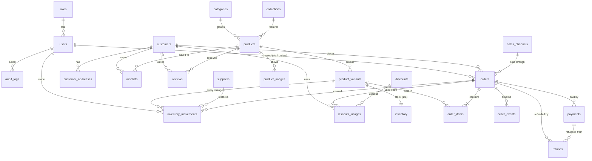

# Entity relationship diagram



## The three chains from the brief

**Customer → Orders → Order items → Product variant → Inventory**
```
customers 1───* orders 1───* order_items *───1 product_variants 1───1 inventory
                                  (snapshots: name, SKU, variant, price, cost)
```

**Product → Variants → Inventory movements**
```
products 1───* product_variants 1───* inventory_movements
                     │                  (SALE, RETURN, RESTOCK, PURCHASE, ADJUSTMENT, DAMAGED, LOST, TRANSFER, MANUAL)
                     └──1───1 inventory   stock_quantity = Σ movements.quantity
```

**Order → Payment → Refund**
```
orders 1───* payments 1───* refunds
   └──────────1───* refunds   (refund_total on the order = Σ refunds)
```

Views: `variant_stock` (variant + inventory + product → available and status) and `customer_stats` (customers + paid orders → totals and lifetime value).
